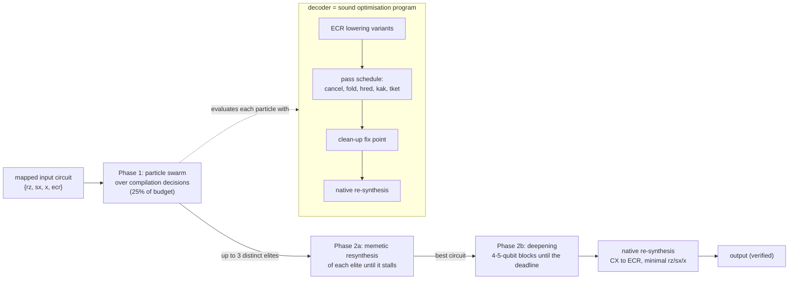

# HyPSO-QCO: results brief for writing the paper

**What this is.**  A self-contained summary of the method, the experiments
and all results of HyPSO-QCO, a particle-swarm framework for quantum circuit
optimisation.  It is meant to be handed to a writing assistant as the single
source of truth for a research paper.

**Rules for whoever writes from this brief.**
1. Use only the numbers stated here, or in the files listed in §12.  Do not
   round differently, and do not add results that are not here.
2. Keep the honesty statements in §8 and §9.  Some parts of the framework
   do not help, and the paper must say so, not hide it.
3. The paper cited in the original task was never provided.  Do not claim a
   comparison with it.
4. Everything was produced by the code in the repository
   `mwalidcharrwi/PSO_Optimization`, branch
   `claude/quantum-circuit-pso-optimization-ux6ipc`.

---

## 1. Key messages (one line each)

1. **Problem.**  Re-optimise quantum circuits that are already compiled for
   IBM hardware (gate set {rz, sx, x, ecr}, fixed qubit mapping).  The main
   target is the number of two-qubit (ECR) gates, the dominant error source.
   The output must stay on the same physical qubits, use only connections
   the input already uses, and keep the hardware's gate directions.
2. **Method.**  HyPSO-QCO is a two-phase **memetic particle-swarm
   framework**.
   * Phase 1: a PSO searches over the *decisions* of a semantics-preserving
     compiler, not over circuits.  Every candidate is exactly equivalent to
     the input by construction.
   * Phase 2: a memetic local search re-synthesises small blocks of the
     best swarm solutions.  It deletes CNOTs **only inside each block's own
     CNOT skeleton**, so the device mapping cannot change.
3. **Main result.**  On the 10 supplied benchmark circuits, HyPSO-QCO has
   the fewest two-qubit gates on **all 10**, against Qiskit O3, TKET, QUESO
   and GUOQ (Wilcoxon p = 0.001 against each).
   * Mean ECR reduction: 31.3 %.  The best related tool, GUOQ, reaches
     20.2 %.
   * Mean total-gate reduction: 55.6 % (GUOQ: 43.4 %).
4. **Fairness.**  Same 15-minute budget, same machine, same rules for all
   tools.  With one worker process (GUOQ's search is single-threaded),
   HyPSO-QCO still beats GUOQ on 6 of 7 circuits.
5. **Correctness.**  Every output was checked end to end against its
   input, except on `hubbard_18` (31 qubits, 357k gates), where no tool's
   output could be checked end to end (§6.6).  HyPSO-QCO's checked outputs
   deviate by at most 5.7e-8 (numerically exact); GUOQ reaches 5.4e-6 on
   one circuit.
6. **Honest attribution.**  On these circuits, the advantage comes from the
   memetic resynthesis phase, **not** from the swarm.  Giving the whole
   budget to the memetic phase is slightly better (38.3 % vs 37.3 % mean
   ECR reduction on 7 circuits).
7. **Where the PSO does matter.**  On logical (not yet mapped) circuits:
   * The PSO formulation significantly beats canonical PSO (p ≤ 0.004 on 3
     suites) and the greedy compiler it wraps.
   * It ties with GA and SA (never significantly worse).
   * Its largest measured effect comes from searching decomposition
     variants.  Removing them costs 15.5 percentage points of gate
     reduction.

---

## 2. Problem setting

* **Input.**  A circuit already laid out and routed for a 127-qubit
  IBM-Eagle device, in {rz, sx, x, ecr}.  Every ECR acts on a coupled pair,
  in the device's native direction.
* **Output contract** (applied to every method):
  1. unitary equivalence up to a global phase, **on the same physical
     qubits** (no relabelling, no final permutation);
  2. two-qubit gates **only on qubit pairs already coupled in the input**,
     with ECRs in the native direction;
  3. gate set {rz, sx, x, ecr}.
* **Objective.**  Lexicographic: (number of ECRs, total gates, depth).
  * rz is virtual on IBM hardware (a frame change), so physical
    single-qubit cost = sx + x.
  * Estimated success probability uses ECR error 7e-3 and sx/x error
    2.5e-4, with rz free.

---

## 3. Method (what to describe in the Method section)

### 3.1 Overview

Rendered figure: `figures/diag1_framework_workflow` (editable source in
`figures/src/`).  Simplified sketch:



### 3.2 Phase 1: PSO over compilation decisions

**Core idea (applies to all modes).**
* Prior PSO work encodes gates directly in the particle, so most
  candidates are not equivalent to the target.  Those methods also need a
  fidelity estimate as fitness and stay at a few qubits.
* HyPSO-QCO instead wraps a **semantics-preserving optimisation program**
  and exposes its free decisions as a genome (all genes in [0, 1)).
* Every particle therefore decodes to a circuit exactly equivalent to the
  input ("equivalence by construction").
* A decode takes roughly linear time in the circuit size, so the method
  scales to circuits with 357k gates.

**Genome segments.**

| segment | decides | used in |
|---|---|---|
| variant genes | decomposition choice of every multi-variant gate.  Toffoli/CCZ: all 108 minimal 6-CNOT networks plus 12 nearest-neighbour 8-CNOT networks, found by BFS, × T/T† polarity × placement.  CZ, SWAP, CP, CRZ, RZZ/RXX/RZX, CSWAP orientations.  **IBM mode: 16 exact ECR→CNOT Clifford lowerings per ECR (2 orientations × 8 cheapest)** | all modes |
| lowering-mode gene (IBM, v2) | per-ECR variants vs the exact greedy ECR→CX conversion | IBM mode |
| schedule genes | 6 slots, each ∈ {skip, cancel, fold, hred, fold+cancel, kak}; IBM mode adds **tket** (TKET `KAKDecomposition` + `CliffordSimp` with `allow_swaps=False`, checked by simulation) | all modes |
| placement genes (opt-in) | where a merged phase rotation is placed (sound by a path-sum argument) | off by default; it hurt in the ablation |
| hardware genes | random-key initial layout + 4 SABRE router parameters | hardware (logical→device) mode |

**Sound passes in the decoder.**
* `cancel`: commutation-aware cancellation.
* `fold`: global path-sum phase folding.
* `hred`: Nam et al. Hadamard reduction.
* `kak`: optimal 2-qubit resynthesis with Shende–Markov–Bullock counts.
* `fuse`: single-qubit fusion.
* A clean-up fix point iterates the passes.
* IBM mode ends with **native re-synthesis**: every CNOT becomes one ECR in
  its pair's native direction.  The best of the 64 exact Clifford wrappings
  is chosen greedily, and each single-qubit run is written with the fewest
  {rz, sx, x} gates (1, 3 or 5).

**Swarm dynamics.**
* **Categorical PSO** for the nominal genes.  Each particle holds a
  probability vector per gene:
  `w ← χ[w + c1 r1 (e(p_i) − π) + c2 r2 (e(l_i) − π)]`, `π ← normalise(max(π + w, 0))`.
  Genes are sampled with an exploration floor of 0.02.
* **Hybrid SPSO/QPSO** for the continuous genes (probability 0.5 each;
  QPSO β decreases from 1.0 to 0.5).
* Constants: χ = 0.7298, c1 = c2 = 1.49618, v_max = 0.35.  Swarm size 16.
* **Search control:**
  * dynamic topology (von Neumann for the first half of the budget, then
    gbest);
  * elitist seeding with the deterministic compiler, so the swarm is never
    worse than greedy;
  * opposition-based initialisation;
  * adaptive turbulence, and partial restarts after 5 stagnant iterations;
  * memoisation of decoded phenotypes; the budget counts unique
    evaluations.
* **Provenance-aligned genome.**  Every emitted gate carries a key path
  (input gate, …, semantic role).  Genes are keyed by these tags, so gene i
  means the same decision in every particle.
* **Provenance-guided local search** on the global best, with adaptive
  operator selection (probability matching over 6 move types).
* **IBM mode seeds** (three elites):
  1. the greedy schedule;
  2. greedy ECR→CX conversion + TKET + greedy schedule;
  3. variant lowering + TKET + greedy schedule.
* **Budget.**  In time-limited IBM runs the swarm gets 25 % of the budget.
  On circuits with more than 50,000 gates one decode takes minutes, so the
  swarm is skipped and the strongest seed starts phase 2 ("large mode").
  This was used for `heisenberg_32`, `grover_10` and `hubbard_18`.

### 3.3 Phase 2: memetic, connectivity-preserving resynthesis

Each **round** runs four steps:

1. **Partition** the current {1q, CX} circuit into convex blocks of at most
   k qubits (k = 3, 4 or 5).
   * A greedy scan keeps each qubit "open" in at most one block and merges
     open blocks only while their union fits.
   * Blocks are re-inserted by contracting the DAG and topologically
     re-linearising it.  This is correct for any convex block; a
     non-convex one would show up as a cycle.
2. **Resynthesise each block by CNOT deletion.**
   * **Template:** V(x) = L_m ⋯ L_1 L_0, where L_0 is a U3 layer and each
     L_j = (U3 ⊗ U3) · CX_j follows the block's **own CNOT skeleton**.  Only
     existing CNOTs are ever deleted, so no new qubit interaction can
     appear.
   * **Exact start:** fold every single-qubit run into the U3 slot after
     the preceding CNOT on its qubit.
   * **Deletion:** try CNOTs one by one in two sweeps (backward, then
     forward).  After each tentative deletion, re-instantiate by
     Levenberg–Marquardt with an analytic, vectorised Jacobian.
     * The solver warm-starts from the previous solution.
     * It aborts early on stagnation.  Successful fits need a median of
       about 11 iterations.
   * **Acceptance:** ‖V(x) − e^{iφ}U‖_F < 1e-10.
   * **Pruning:** a Schmidt-rank lower bound (one CNOT at most doubles the
     operator Schmidt rank across a single-qubit cut) skips impossible
     deletions.
   * **Long 3-qubit blocks** (more than 20 CNOTs) are first refitted to a
     generic alternating 20-CNOT template on the block's own two coupled
     pairs.
   * **"Deep" strategy:** 2 PSO-seeded restarts per deletion, plus deletion
     of CNOT pairs on the same qubit pair.
3. **Z-slot sparsification.**  Each U3 slot of a resynthesised block is
   tentatively restricted to an Rz, which is free on IBM hardware, and the
   block is re-instantiated.
4. **Exact clean-up passes.**  Accept the round if the CNOT count did not
   increase.

**Schedule of phase 2.**
* **Adaptive operator selection:** probability matching on CNOTs saved per
  second, over 12 strategies (scan direction × random cuts × block size
  3/4/5 × restarts).
* Block results are memoised; blocks run largest-first in a pool of
  4 worker processes.
* **Phase 2a:** refine up to three distinct swarm elites, each until it
  stalls (every strategy failed twice in a row).
* **Phase 2b ("deepening"):** continue on the best circuit with blocks of
  up to 5 qubits until the deadline.

### 3.4 Soundness and run-time safety nets

* **Phase 1 is exact.**  Its only external pass (TKET) is checked by
  simulation, and a result deviating by more than 1e-9 is discarded.
  * Circuits with up to 20 used qubits are checked whole.
  * Wider circuits are processed in convex blocks of up to 10 qubits, each
    checked separately.  On `hubbard_18`, 465 blocks were checked and none
    was rejected.
  * TKET's `SynthesiseTket` is **excluded**: it silently dropped a
    `rz(3.8e-4)` on `qae_17`.
* **Phase 2 is numerically exact per block.**  Two run-time safety nets:
  1. every replaced block is re-simulated against the original block
     (tolerance 1e-8);
  2. for circuits with up to 20 used qubits, every accepted round is
     checked against its predecessor with random states (tolerance 1e-7).
* A rejected step is logged and skipped.  **No step was rejected in the
  final runs.**

### 3.5 Default parameters (v2, IBM mode)

| parameter | value |
|---|---|
| wall-clock budget T | 900 s |
| swarm share | 25 % of T (`resynth_share = 0.75`) |
| elites refined | 3 |
| block size (phase 2a / deepening) | ≤ 4 / ≤ 5 qubits |
| resynthesis workers | 4 processes |
| acceptance residual | 1e-10 (Frobenius) |
| block / round safety tolerance | 1e-8 / 1e-7 |
| large-circuit threshold | 50,000 gates |
| swarm size, χ, c1, c2 | 16, 0.7298, 1.49618, 1.49618 |

Recommended setting from the ablation (§6.4) for already-mapped circuits
at short budgets: `--resynth-share 1.0` (no swarm phase).

---

## 4. Contributions and their evidence

Novelty statements are relative to the reviewed literature (§11).  They are
"not found in the reviewed work", not the result of an exhaustive search.

| # | contribution | evidence | status |
|---|---|---|---|
| C1 | PSO over **decisions of a sound compiler** instead of over circuits: exact equivalence by construction, scales to 357k gates | all outputs verified; runs on every benchmark | supported |
| C2 | **Decomposition-variant library as search space** (BFS-enumerated Toffoli networks, ECR lowerings, …) | largest effect in the swarm ablation: without it, 26.1 % vs 41.6 % gate reduction (6/6, p = 0.016) | supported |
| C3 | **Categorical PSO** for nominal genes + hybrid SPSO/QPSO for continuous genes | continuous relaxation instead: −1.2 pp (6/6, p = 0.016); vs canonical PSO: better on 3 suites (p ≤ 0.004) | supported |
| C4 | provenance-aligned genome + provenance-guided local search | no significant effect in the ablation | **not supported** at the tested budgets |
| C5 | free placement of folded rotations (path-sum soundness) | hurts (−0.9 pp, p = 0.016), so opt-in | **not supported** |
| C6 | hardware co-optimisation (layout, router parameters, nearest-neighbour Toffoli networks in one swarm) | IBM Tokyo: 15.8 % fewer CNOTs than Qiskit, 19.9 % fewer than TKET; ties GA/SA | partly supported |
| C7 | IBM-native re-synthesis (greedy choice among 64 exact Clifford wrappings, minimal {rz, sx, x} runs) | most of v1's total-gate reduction (median −20 %) | supported, deterministic (not PSO) |
| C8 | Choi-state MPS miter for verifying 30+ qubit circuits | verified `heisenberg_32` (1.6e-10) | tooling; not a new idea |
| **C9** | **memetic, connectivity-preserving block resynthesis** for mapped circuits (CNOT deletion inside the block skeleton, Schmidt-rank bounds, generic refit, pair deletion, DAG-contraction rebuild, adaptive selection over 12 strategies) | step from 1.9 % (v1) to 31.3 % (v2) mean ECR reduction; beats all related tools on 10/10 | **main driver of the result** |
| C10 | Z-slot sparsification of resynthesised blocks (virtual Rz) | v2 has the fewest physical single-qubit gates on 9/10 circuits (mean −52.2 % vs −39.5 % for GUOQ) | supported (no isolated ablation in the final runs) |
| C11 | swarm → memetic coupling (distinct elites as starting points, PSO-seeded restarts) | no-swarm ablation is better on 5/7 circuits | **not supported** at 15 min |
| C12 | TKET's connectivity-preserving passes as a checked entry of the pass library | TKET's contribution, not ours | engineering |

**Not our ideas (must be cited):**
* gate deletion by re-instantiation: BQSKit's scanning gate removal;
* partition and resynthesise: BQSKit and GUOQ;
* optimal 2-qubit CNOT counts: Shende–Markov–Bullock;
* SABRE routing: Li et al.;
* the TKET passes;
* Nam et al.'s rewrite rules.

---

## 5. Experimental setup

### 5.1 Benchmarks (supplied set `test_circuits_new`)

| circuit | used qubits | gates | ECR | sx + x | depth |
|---|---:|---:|---:|---:|---:|
| mult_8 | 8 | 1,898 | 311 | 638 | 1,138 |
| heisenberg_8 | 8 | 2,127 | 420 | 740 | 529 |
| add_17 | 17 | 2,812 | 499 | 907 | 1,003 |
| qae_17 | 17 | 3,033 | 541 | 982 | 1,066 |
| qft_16 | 16 | 3,444 | 614 | 1,111 | 1,009 |
| hubbard_8 | 8 | 8,125 | 1,344 | 2,659 | 4,400 |
| hhl_8 | 8 | 18,165 | 2,377 | 6,562 | 10,641 |
| heisenberg_32 | 32 | 58,848 | 3,942 | 19,206 | 7,143 |
| grover_10 | 10 | 93,235 | 16,397 | 31,156 | 43,923 |
| hubbard_18 | 31 | 357,535 | 33,958 | 116,414 | 136,644 |

* All circuits are on a 127-qubit IBM-Eagle coupling map.  "Used qubits"
  counts the qubits the circuit touches.  `hubbard_18` touches 31 physical
  qubits.
* None of these files appears in the published evaluation suites of the
  related tools, so every tool was run here.

### 5.2 Compared methods

| method | version / configuration |
|---|---|
| Qiskit O3 | Qiskit 2.5.2, `generate_preset_pass_manager(3)`, basis {rz, sx, x, ecr}, directed coupling map = input's ECR directions, trivial layout.  It failed on `heisenberg_32` and `hubbard_18` and was re-run with an undirected map, which breaks the contract (see §6.6). |
| TKET | pytket 2.18.4; fixed point of `SynthesiseTket`, `KAKDecomposition(allow_swaps=False)` and `CliffordSimp(allow_swaps=False)`.  `FullPeepholeOptimise` is not used: it can couple uncoupled qubits. |
| QUESO (PLDI'23) | GUOQ binary (commit 8c4c3a5) with the authors' QUESO flags `-opt TOTAL -search BEAM -temp 0 -q 8000 -resynth NONE`, plus `--preserve-mapping`; 900 s |
| GUOQ (ASPLOS'25) | commit 8c4c3a5, `-g IBMN -opt TWO_Q -resynth BQSKIT --preserve-mapping`, BQSKit 1.2.1; 900 s, snapshots at 60 s and 300 s.  A small patch makes its BQSKit resynthesis connectivity-aware; without it GUOQ cannot return a valid circuit under this contract.  The patch only restricts GUOQ. |
| BQSKit O3 | `compile(optimization_level=3)` with the input's coupling graph: **did not finish `mult_8` in 35 min**, so it is excluded |
| HyPSO-QCO v1 | swarm only (no memetic phase), 16–300 unique evaluations, 1–3 seeds (earlier experiment, `results/ibm_testset`) |
| **HyPSO-QCO** (v2) | 900 s, 4 resynthesis workers, seed 0 |
| HyPSO-QCO, 1 worker | same, 1 worker: compute-matched with GUOQ's single search thread |
| HyPSO-QCO w/o swarm | ablation: whole budget to the memetic phase, starting from the strongest seed |

**Not runnable under this contract:**
* PyZX and VOQC: do not preserve connectivity;
* Quarl: needs a trained GPU model;
* QALM, OAC and POPQC: no public implementation for this gate set.

**Conversion for CX-based tools.**  They get the input converted exactly to
{rz, sx, x, cx}.  Their output is converted back with the same exact native
lowering that HyPSO-QCO uses, so ECR counts equal their CX counts.

### 5.3 Protocol

* **Machine:** one 4-core container (Intel Xeon 2.8 GHz), 15 GB RAM,
  `OMP_NUM_THREADS=1`.
  * GUOQ and QUESO ran concurrently with each other; GUOQ uses at most
    about 2 cores.
  * HyPSO-QCO runs ran alone.
* **Budget:** 15 minutes wall-clock per circuit for every anytime tool,
  including HyPSO-QCO's decoding and native conversion.  Qiskit and TKET
  run to completion (2–402 s).
* **Seeds:** one seed per method and circuit.
* **Statistics:** per-circuit wins/ties/losses and one-sided Wilcoxon
  signed-rank tests (n = 10; the minimum attainable p is 0.001).
* **Verification** (`qcpso.bench.verify_literature`):
  * random-state test with a shared global phase for ≤ 20 used qubits
    (Qiskit Aer);
  * Choi-state MPS miter otherwise.
  * Deviation classes: < 1e-9 exact, < 1e-6 numerically exact, otherwise
    approximate.

---

## 6. Results

Figures: `paper/figures/` (diagrams `diag1`–`diag4`, charts `fig1`–`fig13`; PDF and PNG; captions in §12).  LaTeX tables:
`paper/tables.tex`.  Data: `paper/data/*.csv`.

### 6.1 RQ1: How does HyPSO-QCO compare with related work?

**Table A: ECR count** (fewer is better; `tab:ecr`, Fig. 1)

| circuit | input | Qiskit O3 | TKET | QUESO | GUOQ | HyPSO-QCO v1 | **HyPSO-QCO** | margin vs best other |
|---|---:|---:|---:|---:|---:|---:|---:|---:|
| mult_8 | 311 | 311 | 299 | 311 | 199 | 309 | **153** | −23.1 % (GUOQ) |
| heisenberg_8 | 420 | 420 | 420 | 420 | 326 | 420 | **276** | −15.3 % (GUOQ) |
| add_17 | 499 | 499 | 495 | 499 | 421 | 491 | **390** | −7.4 % (GUOQ) |
| qae_17 | 541 | 541 | 537 | 541 | 428 | 527 | **420** | −1.9 % (GUOQ) |
| qft_16 | 614 | 614 | 610 | 614 | 536 | 604 | **519** | −3.2 % (GUOQ) |
| hubbard_8 | 1,344 | 1,344 | 1,251 | 1,336 | 1,165 | 1,334 | **930** | −20.2 % (GUOQ) |
| hhl_8 | 2,377 | 2,377 | 2,365 | 2,377 | 500 | 2,375 | **337** | −32.6 % (GUOQ) |
| heisenberg_32 | 3,942 | 4,024‡ | 3,834 | 3,942 | 3,878 | 3,882 | **3,328** | −13.2 % (TKET) |
| grover_10 | 16,397 | 16,397 | 14,453 | 16,397 | 16,393 | 16,395 | **13,543** | −6.3 % (TKET) |
| hubbard_18 | 33,958 | 33,456‡ | 29,547 | 33,926 | 33,829 | 30,415 | **27,559** | −6.7 % (TKET) |
| **mean reduction** | | −0.1 % | 4.1 % | 0.1 % | 20.2 % | 1.9 % | **31.3 %** | |
| geo-mean ratio to input | | 1.001 | 0.958 | 0.999 | 0.744 | 0.980 | **0.626** | |

‡ Undirected-map fallback: this output violates the contract.

**Table B: other metrics, mean reduction vs input over 10 circuits**
(`summary_stats.csv`)

| metric | Qiskit O3 | TKET | QUESO | GUOQ | v1 | **HyPSO-QCO** |
|---|---:|---:|---:|---:|---:|---:|
| ECR | −0.1 % | 4.1 % | 0.1 % | 20.2 % | 1.9 % | **31.3 %** |
| total gates | 10.4 % | 36.2 % | 33.7 % | 43.4 % | 33.0 % | **55.6 %** |
| physical 1q (sx + x) | 9.5 % | 30.5 % | 28.5 % | 39.5 % | 27.7 % | **52.2 %** |
| depth | 9.1 % | 34.4 % | 34.2 % | 39.4 % | 33.3 % | **55.2 %** |

**Table C: total gates per circuit** (`tab:gates`, Fig. 2)

| circuit | input | Qiskit O3 | TKET | QUESO | GUOQ | **HyPSO-QCO** |
|---|---:|---:|---:|---:|---:|---:|
| mult_8 | 1,898 | 1,958 | 1,402 | 1,337 | 1,170 | **808** |
| heisenberg_8 | 2,127 | 2,127 | 1,455 | **1,217** | 1,597 | 1,229 |
| add_17 | 2,812 | 2,916 | 2,203 | 2,108 | 1,980 | **1,662** |
| qae_17 | 3,033 | 3,085 | 2,368 | 2,301 | 2,057 | **1,860** |
| qft_16 | 3,444 | 3,505 | 2,651 | 2,691 | 2,568 | **2,144** |
| hubbard_8 | 8,125 | 8,070 | 5,174 | 6,204 | 4,972 | **3,898** |
| hhl_8 | 18,165 | 19,083 | 14,780 | 16,069 | 2,803 | **1,811** |
| heisenberg_32 | 58,848 | 22,592 | 14,100 | 14,544 | 14,700 | **12,657** |
| grover_10 | 93,235 | 93,315 | 57,497 | 74,687 | 73,279 | **48,187** |
| hubbard_18 | 357,535 | 153,652 | 112,902 | 131,273 | 131,025 | **105,965** |

**Physical single-qubit gates and depth.**
* HyPSO-QCO is lowest on 9 of 10 circuits for both.
* On `heisenberg_8` QUESO is lower: 330 vs 442 physical single-qubit gates
  and depth 302 vs 342.
* Per-circuit numbers: `tab:oneq` and `tab:depth` in `tables.tex`.

**Table D: head-to-head over the 10 circuits** (`tab:stats`)

| HyPSO-QCO vs | ECR W/T/L | p | total gates W/T/L | p |
|---|---|---:|---|---:|
| Qiskit O3 | 10/0/0 | 0.001 | 10/0/0 | 0.001 |
| TKET | 10/0/0 | 0.001 | 10/0/0 | 0.001 |
| QUESO | 10/0/0 | 0.001 | 9/0/1 | 0.002 |
| GUOQ | 10/0/0 | 0.001 | 10/0/0 | 0.001 |
| HyPSO-QCO v1 | 10/0/0 | 0.001 | 10/0/0 | 0.001 |

**Table E: estimated success probability** (ECR error 7e-3, sx/x error
2.5e-4, rz free; a model estimate, not a hardware run)

| circuit | input | TKET | QUESO | GUOQ | **HyPSO-QCO** |
|---|---:|---:|---:|---:|---:|
| mult_8 | 0.0959 | 0.108 | 0.100 | 0.223 | **0.317** |
| heisenberg_8 | 0.0435 | 0.0463 | 0.0482 | 0.0883 | **0.129** |
| add_17 | 0.0239 | 0.0253 | 0.0248 | 0.0438 | **0.0555** |
| qae_17 | 0.0175 | 0.0185 | 0.0181 | 0.0415 | **0.0441** |
| qft_16 | 0.0101 | 0.0108 | 0.0104 | 0.0185 | **0.0215** |
| hubbard_8 | 4.08e-5 | 9.51e-5 | 4.70e-5 | 1.80e-4 | **1.03e-3** |
| hhl_8 | 1.09e-8 | 1.54e-8 | 1.27e-8 | 0.0230 | **0.0791** |
| heisenberg_32 | 7.73e-15 | 5.56e-13 | 2.50e-13 | 3.85e-13 | **2.26e-11** |
| grover_10 | 3.92e-54 | 4.53e-47 | 8.25e-54 | 1.08e-53 | **1.15e-43** |
| hubbard_18 | 5.77e-117 | 2.13e-95 | 1.65e-109 | 3.32e-109 | **5.61e-89** |

The last three circuits are far too deep for current hardware.  They are
scalability tests, not candidates for execution.

**Observations for the discussion.**
* **Rule-based tools barely help here.**  Tools that preserve the mapping
  (Qiskit, TKET, QUESO) barely reduce two-qubit gates on these
  Qiskit-compiled circuits.  Only resynthesis (GUOQ, HyPSO-QCO) does.
  QUESO removes single-qubit gates but no ECRs.
* **GUOQ stalls on the large circuits.**  It reaches ≤ 0.4 % ECR reduction
  on the 90k–360k-gate circuits (`grover_10`, `hubbard_18`) in 15 minutes.
  There TKET is the best related tool.
* **HyPSO-QCO scales.**  It handles those circuits through its large mode
  and checked block-wise TKET: −17.4 % ECR on `grover_10` and −18.8 % on
  `hubbard_18`.

### 6.2 RQ2: Is the comparison fair in compute?

GUOQ's search is single-threaded; HyPSO-QCO normally uses 4 resynthesis
workers.  The 1-worker variant ran with the same 15-minute budget on the 7
circuits of up to 17 qubits (`tab:ablation`, Fig. 4).

| circuit | GUOQ ECR / total | HyPSO-QCO 1 worker | HyPSO-QCO 4 workers |
|---|---|---|---|
| mult_8 | 199 / 1,170 | **164 / 865** | 153 / 808 |
| heisenberg_8 | 326 / 1,597 | **283 / 1,231** | 276 / 1,229 |
| add_17 | 421 / 1,980 | **407 / 1,792** | 390 / 1,662 |
| qae_17 | 428 / 2,057 | **427 / 2,027** | 420 / 1,860 |
| qft_16 | **536** / 2,568 | 541 / **2,296** | 519 / 2,144 |
| hubbard_8 | 1,165 / 4,972 | **968 / 4,065** | 930 / 3,898 |
| hhl_8 | 500 / 2,803 | **329 / 1,756** | 337 / 1,811 |
| mean ECR reduction | 28.6 % | 35.1 % | 37.3 % |

* With 1 worker, HyPSO-QCO has fewer ECRs than GUOQ on **6 of 7** circuits.
  * It loses `qft_16` by 5 ECRs (541 vs 536).
  * It wins `qae_17` by only 1 ECR.
* It has fewer total gates on **7 of 7**.
* Four workers give a further 1.6–6.7 % on six circuits.  On `hhl_8` the
  1-worker run is 2.4 % better.

### 6.3 RQ3: Anytime behaviour (Fig. 3)

Fig. 3 plots the best ECR count so far against wall-clock time for each of
the 7 smaller circuits, for these runs:
* GUOQ and QUESO, sampled at 1, 5 and 15 minutes;
* TKET, drawn as a line;
* HyPSO-QCO with 4 workers and with 1 worker;
* the no-swarm variant.

HyPSO-QCO traces are rebuilt from per-round logs (`anytime_traces.csv`).
The phases are placed back to back, ending at the run's total time.

Readings:
* **HyPSO-QCO** is flat during its swarm phase (first ~4 minutes), then
  drops steeply once the memetic phase starts.
  * It passes GUOQ's final 15-minute value after 4.6–5.9 minutes on
    `mult_8`, `heisenberg_8`, `add_17`, `hubbard_8` and `hhl_8`.
  * It passes it after 10.2 minutes on `qae_17` and 12.4 minutes on
    `qft_16`.
* **The no-swarm variant** drops within the first minute.
  * It passes GUOQ's final value after 0.4–2.6 minutes on six circuits,
    and after 7.5 minutes on `qft_16`.
  * It is at or below every other curve for the whole budget on 6 of 7
    circuits.  On `mult_8` this holds for 88 % of the time; the full
    configuration finishes lower there.
* **GUOQ** at 1 minute has 2.7 % mean ECR reduction over 10 circuits, 14.1 %
  at 5 minutes and 20.2 % at 15 minutes.  It was still improving at
  15 minutes (e.g. `mult_8`: 275 → 231 → 199).

### 6.4 RQ4: What produces the improvement? (ablation)

**Table F: where the ECR reduction arises in the HyPSO-QCO runs**
(`phase_breakdown.csv`)

| circuit | input | after phase 1 (swarm or seed) | best elite after phase 2a | final (after deepening) | memetic rounds |
|---|---:|---:|---:|---:|---:|
| mult_8 | 311 | 280 | 163 | 153 | 185 |
| heisenberg_8 | 420 | 420 | 276 | 276 (no time left) | 276 |
| add_17 | 499 | 471 | 404 | 390 | 227 |
| qae_17 | 541 | 521 | 427 | 420 | 122 |
| qft_16 | 614 | 599 | 536 | 519 | 145 |
| hubbard_8 | 1,344 | 1,207 | 930 (1 elite) | 930 | 71 |
| hhl_8 | 2,377 | 2,259 | 337 | 337 (no time left) | 80 |
| heisenberg_32* | 3,942 | 3,842 | 3,328 | – | 35 |
| grover_10* | 16,397 | 14,462 | 13,543 | – | 6 |
| hubbard_18* | 33,958 | 29,614 | 27,559 | – | 5 |

\* Large mode: phase 1 is only the strongest seed (TKET pass + greedy), with
no swarm.

* Phase 1 removes 0–10.2 % of ECRs on the 7 smaller circuits (the swarm) and
  2.5–12.8 % on the large ones (the seed).  Phase 2 removes most of the
  rest.
* On `heisenberg_8`, `hubbard_8` and `hhl_8` the 3-elite phase used up all
  the time, so the deepening phase, which gives the late gains, never ran.

**Table G: swarm-phase ablation** (7 circuits, 15 min, 4 workers)

| circuit | HyPSO-QCO (swarm 25 % + memetic) ECR / total | w/o swarm phase ECR / total |
|---|---|---|
| mult_8 | **153 / 808** | 156 / 818 |
| heisenberg_8 | 276 / 1,229 | **266 / 1,193** |
| add_17 | 390 / **1,662** | **389** / 1,677 |
| qae_17 | 420 / **1,860** | **413** / 1,890 |
| qft_16 | 519 / **2,144** | 519 / 2,202 |
| hubbard_8 | 930 / 3,898 | **915 / 3,646** |
| hhl_8 | 337 / 1,811 | **275 / 1,528** |
| mean ECR reduction | 37.3 % | **38.3 %** |
| mean total-gate reduction | 51.3 % | **51.7 %** |

* **ECR:** HyPSO-QCO vs no-swarm is 1 win / 1 tie / 5 losses (one-sided
  p = 0.97).  Total gates: 4 wins / 3 losses.
* **Interpretation:** at a 15-minute budget the swarm phase (25 % of the
  time) does not pay for itself.
  * The swarm does lower the starting point: `mult_8` 311 → 280,
    `hubbard_8` 1,321 → 1,207 compared with the no-swarm seed.
  * But the memetic-only run passes those counts within its first minute
    (Fig. 3), and the time spent in the swarm is missing from deepening.
  * The only circuit where the full configuration finishes with fewer
    ECRs is `mult_8` (153 vs 156).
* **Memetic contribution (v1 → v2):** mean ECR reduction 1.9 % → 31.3 %
  over 10 circuits.  The memetic phase is responsible for the result.
* **Z-slot sparsification (C10):** there is no separate ablation in the
  final runs.  Evidence: v2 has 52.2 % fewer physical single-qubit gates,
  against 39.5 % for GUOQ.

### 6.5 RQ5: Is the PSO a good search strategy? (same genome, decoder and budget)

These experiments use the built-in logical suites (programmatic
reconstructions of standard families, 3 seeds): `tab:search`, Fig. 5.

**Table H: mean reduction of the primary metric vs the lowered input;
HyPSO-QCO vs each method as W/T/L (one-sided Wilcoxon p)**

| method | Clifford+T (18; gates) | | continuous (11; CX) | | IBM Tokyo (8; CX) | |
|---|---:|---|---:|---|---:|---|
| greedy (no search) | 22.9 % | 16/2/0 (0.0002) | 13.3 % | 8/3/0 (0.004) | −0.2 % | 8/0/0 (0.004) |
| random search | 31.4 % | 15/3/0 (0.0003) | 16.7 % | 8/3/0 (0.004) | −0.2 % | 8/0/0 (0.004) |
| canonical PSO | 33.3 % | 11/7/0 (0.002) | 18.3 % | 8/3/0 (0.004) | −21.3 % | 8/0/0 (0.004) |
| GA | 34.7 % | 9/7/2 (0.008) | 21.1 % | 5/5/1 (0.047) | 6.3 % | 3/1/4 (0.41) |
| SA | 35.0 % | 6/7/5 (0.36) | 20.7 % | 4/6/1 (0.063) | 5.5 % | 5/1/2 (0.20) |
| Qiskit O3 | 9.2 % | 18/0/0 (1e-4) | 2.2 % | 8/3/0 (0.004) | −10.1 % | 7/0/1 (0.008) |
| TKET | −5.6 % | 18/0/0 (1e-4) | 4.9 % | 8/1/2 (0.005) | −16.5 % | 8/0/0 (0.004) |
| PyZX | −13.9 % | 18/0/0 (4e-6) | −48.4 % | 11/0/0 (5e-4) | – | – |
| **HyPSO-QCO swarm** | **35.0 %** | – | **21.9 %** | – | **6.8 %** | – |

* **Average ranks** (Friedman p ≤ 2e-7 on each suite):
  * Clifford+T: HyPSO 2.11 = SA 2.11 < GA 2.67 < canonical PSO 3.67;
  * continuous: HyPSO 2.45 < GA 2.86 < SA 3.00 < canonical PSO 4.36;
  * Tokyo: HyPSO 2.00 = GA 2.00 < SA 2.38 < canonical PSO 7.38.
* **On the supplied IBM circuits (v1, same decoder):**
  * HyPSO beats SA (ECR p = 0.016, gates p = 0.004);
  * it is not significantly better than GA (ECR 4/4/0, p = 0.063; GA finds
    about 0.3 % fewer total gates) or than canonical PSO (ECR p = 0.14) at
    3 seeds.
* **Honest reading:**
  * The robust PSO-specific claims are "significantly better than the
    canonical PSO of prior work" and "never significantly worse than GA
    or SA".
  * "PSO beats all metaheuristics" is **not** supported.
  * The differences between search strategies (≤ 2 %) are small compared
    with the effect of the formulation (≈ 20 % from the decision space and
    the passes).

**Table I: component ablation of the swarm** (6 Toffoli-heavy circuits,
600 evaluations, 3 seeds; `tab:components`, Fig. 6)

| variant | mean gate reduction | full vs variant W/T/L | p |
|---|---:|---|---:|
| full HyPSO-QCO swarm | 41.6 % | – | – |
| no decomposition variants | 26.1 % | 6/0/0 | 0.016 |
| continuous relaxation (no categorical PSO) | 40.5 % | 6/0/0 | 0.016 |
| with placement genes | 40.7 % | 6/0/0 | 0.016 |
| no elitist seed | 41.2 % | 4/0/2 | 0.16 |
| SPSO only / QPSO only | 41.5 % | 4/0/2 | 0.25 |
| eager placement genes | 41.3 % | 3/1/2 | 0.31 |
| unguided local search | 41.6 % | 3/1/2 | 0.22 |
| gbest topology only | 41.6 % | 3/0/3 | 0.47 |
| no schedule genes | 41.7 % | 1/2/3 | 0.69 |
| no local search | 41.9 % | 3/0/3 | 0.80 |

**v1 stage analysis on the supplied circuits.**
* The deterministic native re-synthesis (C7) gives most of v1's
  total-gate reduction: median −20.2 %.
* The swarm adds a median −3.1 % gates and −0.35 % ECRs.
* On 7 of 10 circuits the swarm is v1's only component that reduces ECRs
  at all.  Per stage: input → native re-synthesis → + 2-qubit
  resynthesis → + swarm:

| circuit | ECR | total gates |
|---|---|---|
| mult_8 | 311 → 311 → 311 → 309.0 | 1,898 → 1,546 → 1,532 → 1,427.7 |
| heisenberg_8 | 420 → 420 → 420 → 420.0 | 2,127 → 1,449 → 1,461 → 1,325.3 |
| add_17 | 499 → 499 → 499 → 493.7 | 2,812 → 2,275 → 2,268 → 2,196.0 |
| qae_17 | 541 → 541 → 541 → 530.0 | 3,033 → 2,466 → 2,467 → 2,398.7 |
| qft_16 | 614 → 614 → 614 → 606.7 | 3,444 → 2,741 → 2,752 → 2,668.3 |
| hubbard_8 | 1,344 → 1,344 → 1,344 → 1,335.3 | 8,125 → 6,222 → 6,144 → 5,956.0 |
| hhl_8 | 2,377 → 2,377 → 2,377 → 2,376.0 | 18,165 → 16,107 → 15,670 → 15,401.5 |
| heisenberg_32 | 3,942 → 3,942 → 3,882 → 3,882.0 | 58,848 → 14,540 → 14,855 → 14,740.0 |
| grover_10 | 16,397 → 16,397 → 16,397 → 16,395.0 | 93,235 → 74,623 → 73,444 → 71,485.0 |
| hubbard_18 | 33,958 → 33,926 → 30,431 → 30,415.0 | 357,535 → 131,273 → 140,926 → 135,134.0 |

**Earlier comparison with external tools on logical circuits (v1 swarm).**
* Clifford+T: 18/18 wins against Qiskit, TKET and PyZX (28.8 %, 37.1 %
  and 41.8 % fewer gates; p ≤ 1e-4).
* Continuous mode: all but the two QFT circuits (TKET is better there by
  2 CNOTs).
* IBM Tokyo: 15.8 % fewer CNOTs than Qiskit and 19.9 % fewer than TKET.
* Much of this advantage already comes from the deterministic pipeline
  inside the decoder.

### 6.6 RQ6: Correctness (`tab:verification`)

| method | largest deviation over checked outputs | class |
|---|---:|---|
| Qiskit O3 | 1.7e-10 (`qae_17`) | exact |
| TKET | 3.5e-9 (`heisenberg_32`) | numerically exact |
| QUESO | 3.8e-9 (`heisenberg_32`) | numerically exact |
| GUOQ | **5.4e-6** (`qft_16`); otherwise ≤ 4.9e-7 | approximate on `qft_16` |
| **HyPSO-QCO** | 2.9e-8 (`grover_10`); `heisenberg_32`: 1.6e-10 | numerically exact |
| HyPSO-QCO, 1 worker | 4.4e-9 | numerically exact |
| HyPSO-QCO w/o swarm | 5.7e-8 (`qft_16`) | numerically exact |

* **Qiskit fallback outputs fail the contract.**  Qiskit's two
  undirected-map outputs (`heisenberg_32`, `hubbard_18`) put ECRs in
  non-native directions.  On `heisenberg_32` its output deviates from the
  input on the same qubits by 0.98.
* **`hubbard_18` has no end-to-end check for any tool.**  At 31 used
  qubits and up to 357k gates, the MPS miter's bond dimension grows too
  large: an end-to-end check was stopped after 90 minutes at 44 % of the
  gates (bond dimension ≥ 256).
  HyPSO-QCO's output there is verified **step by step** by the run-time
  checks (every block, and 465 TKET blocks), with no rejections.
* **Two issues were found by the verification during this work and
  fixed.**  The affected runs are kept apart in
  `results/ibm_literature/superseded/`.
  1. TKET's `SynthesiseTket` drops small rotations (§3.4).  An
     intermediate decode was therefore inexact, and one ablation run
     inherited a 3.8e-4 error.
  2. The TKET pass was applied unchecked, chunk by chunk, on circuits with
     more than 20 qubits.  It was not exact on one `hubbard_18` chunk
     (1e-5).  It was replaced by the checked block-wise pass of §3.4.

  The safety nets of §3.4 were added after these findings.  All reported
  HyPSO-QCO numbers come from the fixed code.

---

## 7. Where HyPSO-QCO does not win

* **`heisenberg_8`:** QUESO has fewer total gates (1,217 vs 1,229), fewer
  physical single-qubit gates (330 vs 442) and lower depth (302 vs 342).
  But QUESO removes no ECR (420 vs 276).
* **Compute-matched `qft_16`:** GUOQ has 536 ECRs against 541 for
  HyPSO-QCO with 1 worker.
* **Small margins:** on `qae_17` (1.9 %) and `qft_16` (3.2 %) the margin
  is within the seed-to-seed spread observed for HyPSO-QCO (±4 %).
* **Exactness:** HyPSO-QCO outputs are numerically exact (≤ 5.7e-8), not
  exact.  Rule-based tools are exact up to rounding.

---

## 8. Threats to validity and limitations (to include in the paper)

1. **One seed per method and circuit.**  Re-running HyPSO-QCO after the
   final code fixes changed its per-circuit ECR counts by −4 % to +4 %.
   All margins over the best other tool are larger than that, except
   `qae_17` (1.9 %) and `qft_16` (3.2 %).
2. **Budget.**  15 minutes per circuit; GUOQ's paper uses 1 hour, and GUOQ
   was still improving.  Longer budgets may narrow the gap; this was not
   measured.
3. **Compute.**  HyPSO-QCO normally uses 4 worker processes; GUOQ uses
   about 2 cores.  The 1-worker run addresses this (6/7 wins).
4. **GUOQ was patched** to respect the fixed mapping.  QUESO used its
   authors' total-gate objective, not an ECR objective.
5. **Baselines that could not be run:** BQSKit timed out; PyZX and VOQC do
   not preserve connectivity; Quarl needs a GPU model; QALM, OAC and POPQC
   have no public implementation.  No published numbers exist for these
   files.
6. **Verification gap:** no end-to-end check of `hubbard_18` for any tool
   (§6.6).
7. **Benchmark set:** 10 circuits from one device family, all compiled by
   Qiskit.  The built-in logical suites are reconstructions of standard
   families, not the original files.
8. **Estimated success probability** is a simple product-of-errors model,
   not a hardware run.
9. **Post-hoc choice:** the no-swarm configuration was identified after
   seeing the results.  The headline numbers use the configuration fixed
   before the runs.

---

## 9. Recommended framing for the paper

* **What the paper can claim:**
  1. a memetic PSO framework whose particles encode decisions of a sound
     compiler (exact candidates, scalable);
  2. a connectivity-preserving resynthesis operator for mapped circuits;
  3. on IBM-mapped benchmarks, fewer two-qubit gates than Qiskit, TKET,
     QUESO and GUOQ on 10/10 circuits under a strict, verified contract;
  4. on logical circuits, the PSO formulation (categorical PSO +
     decomposition variants) significantly beats canonical PSO and ties
     GA/SA.
* **What the paper must not claim:**
  * that the particle swarm is what beats GUOQ on mapped circuits (the
    ablation says otherwise);
  * that PSO beats all metaheuristics;
  * that outputs are exactly (symbolically) equivalent;
  * a comparison with the task's original paper.
* **Suggested honest positioning.**  HyPSO-QCO is a *framework*: the swarm
  explores the discrete compilation space, and memetic resynthesis
  exploits it.
  * On mapped IBM circuits at short budgets the local search dominates.
    The best configuration there is memetic-only, and the paper should
    present that as a finding.
  * The swarm is essential on logical circuits (decomposition variants:
    −15.5 pp without them).
* **Candidate titles:**
  * "HyPSO-QCO: Memetic Particle Swarm Optimisation over Compilation
    Decisions for Quantum Circuit Optimisation";
  * "Connectivity-Preserving Memetic Swarm Optimisation of Hardware-Mapped
    Quantum Circuits".

### Suggested outline → where the material is

| section | content | tables / figures |
|---|---|---|
| 1 Introduction | two-qubit gates dominate error; mapped circuits leave little room for rule-based tools; contributions list (§4, C1–C3, C9, C10) | – |
| 2 Background and related work | §11 | – |
| 3 Problem | §2 (contract) | – |
| 4 Method | §3.1–3.5 | `diag1` (workflow), `diag2` (particle → decoder), `diag4` (block resynthesis) |
| 5 Setup | §5 | `diag3` (evaluation protocol), `tab:benchmarks` |
| 6.1 vs related work | §6.1 | `tab:ecr`, `tab:gates`, `tab:stats`, `fig1`, `fig2`, `fig9`, `fig10`, `fig7`, `fig11` |
| 6.2 compute-matched | §6.2 | `tab:ablation`, `fig4` |
| 6.3 anytime | §6.3 | `fig3`, `fig12` |
| 6.4 ablation | §6.4 | Table F/G, `fig8`, `fig4` |
| 6.5 PSO as search strategy | §6.5 | `tab:search`, `tab:components`, `fig5`, `fig6` |
| 6.6 correctness | §6.6 | `tab:verification`, `fig13` |
| 7 Discussion / limitations | §7, §8, §9 | – |

---

## 10. Draft abstract (edit freely; numbers are final)

> Two-qubit gates dominate the error budget of superconducting quantum
> processors, yet circuits that have already been mapped to a device leave
> little room for rule-based optimisers. We present HyPSO-QCO, a memetic
> particle-swarm framework for quantum circuit optimisation. Instead of
> encoding circuits, particles encode the decisions of a
> semantics-preserving compiler (decomposition variants, native-gate
> lowerings and pass schedules), so every candidate is equivalent to the
> input by construction and the search scales to circuits with hundreds of
> thousands of gates. A memetic phase refines the best candidates by
> connectivity-preserving numerical resynthesis: it deletes CNOTs only
> inside each block's own CNOT skeleton, so the device mapping cannot
> change. On ten IBM-Eagle-mapped benchmark circuits (up to 357k gates),
> under a strict same-qubit, same-coupling contract and a 15-minute budget,
> HyPSO-QCO uses fewer two-qubit gates than Qiskit, TKET, QUESO and GUOQ on
> every circuit, reducing the ECR count by 31.3 % on average (GUOQ: 20.2 %)
> and the total gate count by 55.6 % (GUOQ: 43.4 %). All outputs are
> verified to be numerically exact (deviation ≤ 5.7e-8), except the
> largest one, which is verified block by block. An ablation shows
> that on these mapped circuits the gains come from the memetic
> resynthesis, whereas on logical circuits the swarm's categorical search
> over decomposition variants significantly outperforms canonical PSO.

---

## 11. Related work to cite (condensed; full survey in `docs/RELATED_WORK.md`)

* **Rule-based / phase polynomials:**
  * Nam, Ross, Su, Childs & Maslov, npj QI 2018;
  * Amy, Maslov & Mosca (Tpar), IEEE TCAD 2014;
  * Amy, Azimzadeh & Mosca (Gray-synth), QST 2018;
  * Iten et al., template matching, ACM TQC 2022;
  * Hietala et al. (VOQC), POPL 2021;
  * Maslov et al., IEEE TCAD 2008;
  * Abdessaied, Soeken & Drechsler, RC 2014.
* **Industrial compilers:**
  * Sivarajah et al. (t|ket⟩), QST 2020;
  * Javadi-Abhari et al. (Qiskit), 2024.
* **ZX-calculus:**
  * Duncan, Kissinger, Perdrix & van de Wetering, Quantum 2020;
  * Kissinger & van de Wetering, PRA 2020 / PyZX, QPL 2019.
* **Superoptimisation and resynthesis:**
  * Xu et al. (Quartz), PLDI 2022;
  * Xu et al. (QUESO), PLDI 2023;
  * Xu et al. (GUOQ), ASPLOS 2025;
  * Li et al. (Quarl), OOPSLA 2024;
  * Davis et al. (QSearch), QCE 2020;
  * Younis et al. (QFAST), QCE 2021;
  * Smith et al. (LEAP), ACM TQC 2023;
  * BQSKit;
  * Shende, Markov & Bullock, PRA 2004.
* **Learning / autotuning:**
  * Fösel et al., arXiv:2103.07585;
  * Ruiz et al. (AlphaTensor-Quantum), Nat. Mach. Intell. 2025;
  * Quetschlich, Burgholzer & Wille, DAC 2023.
* **Mapping and routing:**
  * Li, Ding & Xie (SABRE), ASPLOS 2019;
  * Zulehner, Paler & Wille, IEEE TCAD 2019;
  * Cowtan et al., TQC 2019;
  * Tan & Cong (OLSQ), ICCAD 2020.
* **PSO foundations:**
  * Kennedy & Eberhart 1995;
  * Clerc & Kennedy, IEEE TEVC 2002;
  * Sun, Feng & Xu (QPSO), CEC 2004;
  * Kennedy & Mendes (topologies), CEC 2002;
  * Strasser et al. (categorical PSO), GECCO 2016;
  * Tizhoosh (opposition-based learning) 2005;
  * Thierens (adaptive operator selection) 2005.
* **PSO / swarms for quantum circuits (the gap):**
  * Hidayat & Cheah, arXiv:2507.02898 (2025): gates encoded directly,
    small circuits;
  * swarm algorithms for quantum circuit design (iSOMA/DE/PSO, Applied
    Soft Computing 2023; IJPEDS 2025);
  * PSO-based reversible circuit synthesis (2012–2013);
  * DPSO+DRL mapping, Swarm and Evolutionary Computation 2025.
  * Common limits: circuit-space encodings with fidelity fitness, a few
    qubits, one stage only.

**Gaps addressed:**
* G1: exact decision-space encoding instead of circuit-space encoding.
* G3: categorical PSO for nominal decisions.
* G9: superoptimisers' resynthesis ignores the device connectivity of
  already-mapped circuits.

(Check each reference's details before citing; the survey was written
without access to a bibliography database.)

---

## 12. Files and reproduction

**Paper package (`paper/`):**

| file | content |
|---|---|
| `PAPER_BRIEF.md` | this brief |
| `tables.tex` | LaTeX tables (`booktabs`): `tab:benchmarks`, `tab:ecr`, `tab:gates`, `tab:oneq`, `tab:depth`, `tab:stats`, `tab:ablation`, `tab:verification`, `tab:search`, `tab:components` |
| `figures/diag1_framework_workflow` (.pdf/.svg/.png) | two-phase framework workflow |
| `figures/diag2_particle_decoding` | particle encoding → decoder → cost → swarm update |
| `figures/diag3_evaluation_protocol` | experimental protocol |
| `figures/diag4_block_resynthesis` (.pdf/.png) | one block-resynthesis step at circuit level |
| `figures/src/*.mmd` | editable Mermaid sources of `diag1`–`diag3` |
| `figures/fig1`–`fig13` (.pdf/.png) | data charts (captions below) |
| `data/benchmarks.csv` | input characteristics |
| `data/ibm_comparison.csv` | every method × circuit: ECR, sx+x, gates, depth, time, reduction, deviation |
| `data/summary_stats.csv` | mean reductions, W/T/L and Wilcoxon p |
| `data/compute_matched_and_ablation.csv` | Tables §6.2 / §6.4 |
| `data/phase_breakdown.csv` | Table F |
| `data/anytime_traces.csv` | Fig. 3 data |
| `data/builtin_*.csv` | logical-suite results, ranks and ablation |
| `build_package.py` | regenerates everything above from `results/` |

**Suggested figure captions** (all figures share one colour system:
HyPSO-QCO blue, GUOQ orange, TKET green, QUESO yellow, Qiskit pink;
HyPSO-QCO variants and pipeline stages in shades of blue):

*Method diagrams*
* **diag1 (framework workflow).**  HyPSO-QCO.  Phase 1: a particle swarm
  searches the decisions of a sound compiler, so every candidate is exactly
  equivalent to the input.  Phase 2: the best distinct candidates are
  refined by memetic, connectivity-preserving block resynthesis until the
  deadline.
* **diag2 (particle decoding).**  A particle is a vector of decision genes
  keyed by provenance.  The decoder lowers gates with the chosen variants,
  runs the chosen passes, cleans up and re-synthesises native gates.
  Categorical PSO updates one probability vector per gene.
* **diag3 (evaluation protocol).**  Every optimiser receives the same
  mapped circuits under one contract.  Outputs are converted back to native
  gates the same way, checked for equivalence and measured with the same
  metrics.
* **diag4 (block resynthesis).**  One resynthesis step:
  (a) a convex block cut from the mapped circuit;
  (b) the parameterised template on the block's own CNOT skeleton;
  (c) CNOT deletion with Levenberg–Marquardt re-instantiation;
  (d) Z-slot sparsification.
  Only existing CNOTs can disappear, so the device mapping is unchanged.

*Results charts*
* **fig1.**  Two-qubit (ECR) gate reduction relative to the input on the ten
  IBM-Eagle-mapped benchmarks (15 min per circuit for the anytime tools).
  Labels give HyPSO-QCO's reduction.
* **fig2.**  Total native gate reduction relative to the input.
* **fig3.**  Best ECR count found so far over wall-clock time.
  * GUOQ and QUESO are sampled at 1, 5 and 15 min; TKET is shown as a
    line.
  * HyPSO-QCO traces are rebuilt from per-round logs.
  * The flat start of HyPSO-QCO and of its 1-worker variant is the swarm
    phase.
* **fig4.**  ECR count relative to GUOQ (15 min) for HyPSO-QCO with 4
  workers, with 1 worker (compute-matched) and without the swarm phase.
  Only the full configuration was run on the three large circuits.
* **fig5.**  Search strategies on the same genome, decoder and budget
  (logical suites, 3 seeds): mean reduction of the primary metric.
* **fig6.**  Component ablation of the swarm: change in mean gate
  reduction when one component is removed.  Blue marks components whose
  removal is significantly worse (one-sided Wilcoxon, p < 0.05).
* **fig7.**  Absolute number of ECR gates removed, by circuit ordered by
  size (log scale).  HyPSO-QCO removes the most ECRs on every circuit, up
  to 6,399 on `hubbard_18`.  GUOQ's removals collapse on the three
  largest circuits (64, 4 and 129).
* **fig8.**  Where HyPSO-QCO's ECR reduction arises: the share of the
  input's ECRs removed by phase 1 (the swarm, or only the seed for the
  three large circuits, marked *), by memetic resynthesis of the elites
  (2a) and by deepening (2b).
* **fig9.**  ECR count of each tool divided by HyPSO-QCO's (≥ 1 everywhere;
  darker = more ECRs than HyPSO-QCO).
* **fig10.**  Mean reduction over the ten circuits in four metrics: ECR,
  total gates, physical single-qubit gates (sx + x) and depth.
* **fig11.**  Gain in estimated success probability over the input for
  the seven executable-size circuits.  Model: ECR error 7e-3, sx/x error
  2.5e-4, rz free.
* **fig12.**  Minutes until each HyPSO-QCO configuration's ECR count drops
  below GUOQ's final 15-minute result.
* **fig13.**  Deviation of every output from its input (log scale), with
  the exact / numerically exact / approximate bands.  Qiskit's
  `heisenberg_32` output, which breaks the contract (0.98), is omitted.
  `hubbard_18` is not shown for any tool.

**Other sources in the repository:**
* `results/ibm_literature/REPORT.md`: full comparison report.
* `results/ibm_literature/README.md`: protocol.
* `results/ibm_literature/verification.csv`: all deviations.
* `results/ibm_literature/*/optimized/*.qasm`: every optimised circuit.
* `docs/FRAMEWORK.md`: method details.
* `docs/CONTRIBUTION_ASSESSMENT.md`: contribution analysis.
* `docs/RELATED_WORK.md`: literature survey.

**Reproduce:**

```bash
export PYTHONPATH=. OMP_NUM_THREADS=1
python -m qcpso optimize mapped.qasm -o out.qasm --mode ibm --time-limit 900 --resynth-workers 4
scripts/run_ibm_literature.sh                           # HyPSO-QCO runs, 1-worker variant, ablation
python -m qcpso.bench.compare_ibm --out results/ibm_literature/guoq --methods guoq --time-limit 900 --snapshots 60,300
python -m qcpso.bench.verify_literature results/ibm_literature --large
python paper/build_package.py                           # tables, figures, data of this package
```

**Software versions:** Python 3.11, Qiskit 2.5.2, Qiskit Aer 0.17.2,
pytket 2.18.4, BQSKit 1.2.1, GUOQ/QUESO commit 8c4c3a5, NumPy 2.4.6,
SciPy 1.17.1, quimb 1.15.0.
